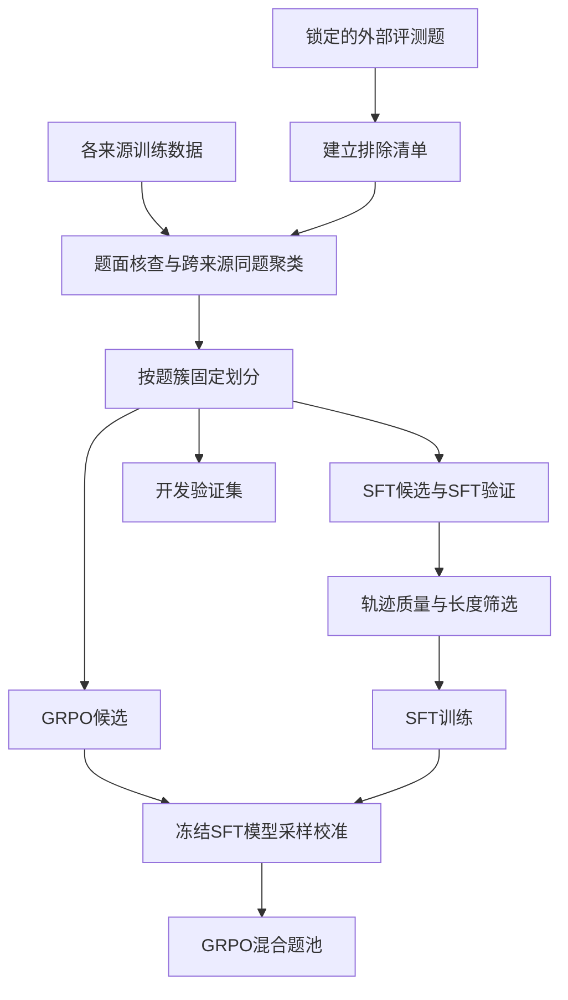

# 数据设计方案：SFT示范学习与GRPO可学习题组

> 2026-10-13：本文通用多来源配方已退出当前主实验，保留为历史设计参考。当前统一采用[MATH Level 2–3主线配置](MATH_L2_L3_DATA_CONFIGURATION.md)：初始505条来自OpenMathReasoning-mini，新实验预留200道MATH开发题、600道MATH SFT候选，GRPO使用剩余MATH题；GSM8K仅作可选补充。下文1500题、300题验证、75/25和25/50/25等旧预算不再是执行配置。

状态：建议方案，尚未构建或训练。适用范围：单卡Qwen3-4B数学后训练。整理与来源核对日期：2026-10-12。

本方案允许重新设计数据，不沿用历史505条SFT和主GRPO题池规模。所有条数、比例、阈值均为本项目可试验的起始配置，不是已经使用的数据，也不是上游项目的统一最佳实践。历史经历仍见[训练记录](TRAINING_RECORD.md)。

针对实际SFT退步题的定向补充方案与完整GRPO消融安排，见[项目推进主线](PROJECT_DEVELOPMENT_STORY.md)。本文1500题通用方案与其中“复核原集+800题”的定向方案是不同起步选择，不要求叠加。

当前明确以MATH L2–3和SFT能力保持为目标时，优先使用[任务数据划分与保守SFT方案](SFT_ACCURACY_PRESERVATION.md)：选择同等级的train题、筛选适合Base的合格示范，并先验证小幅更新；本文通用1500题配方作为扩展备选。

GRPO部分已统一到[当前GRPO数据方案](GRPO_DATA_PLAN.md)。当前采用512候选试运行、最多1024题合格池、3894 completion预算；旧版6000候选和1500–3000实际训练目标不再作为首轮承诺。

## 1. 参考开源项目的哪些部分

| 来源 | 可以确认的做法或资源 | 本项目取舍 |
|---|---|---|
| [SimpleRL-Zoo](https://github.com/hkust-nlp/simpleRL-reason#dataset) | 使用GSM8K/MATH、规则奖励；提供Easy、Medium、Hard数据组合 | 借鉴静态难度分组，不照搬其规模、硬件或收益 |
| [Open-R1 pass-rate filtering](https://github.com/huggingface/open-r1/blob/main/scripts/pass_rate_filtering/README.md) | 通过生成回答并计算正确比例过滤可验证任务 | 用当前SFT checkpoint估计题目的模型相对难度 |
| [OpenR1-Math-220k](https://huggingface.co/datasets/open-r1/OpenR1-Math-220k) | 提供问题、答案、生成轨迹和逐轨迹完整性/正确性字段 | 仅抽取经再次检查、长度合适的轨迹作为可选SFT来源 |
| [GSM8K](https://github.com/openai/grade-school-math#dataset-details) | 多步算术应用题，带解答与最终答案字段 | 提供算术、比例、单位和文字建模样本 |
| [MATH](https://github.com/hendrycks/math) | 竞赛数学数据及解答；可按原始level与subject组织 | 提供代数、数论、计数概率、几何等层次 |
| [DAPO原文](https://arxiv.org/html/2503.14476v2#S3.SS2) | 动态采样过滤全同正确性题组，并补充采样 | 先用静态筛选跑通；在线补采样单独消融并核算成本 |

SimpleRL原配方中Easy包含GSM8K/MATH L1，Medium包含MATH L1–4，Hard包含MATH L3–5，组间有重叠。下面自定义的互斥分桶只是为了本项目方便统计，不称为SimpleRL原始划分。

Open-R1主仓库目前注明不再维护，此处参考其公开方法和数据，训练接口以项目选定的TRL版本为准。

## 2. 先区分SFT与GRPO的选数目的

| 比较项 | SFT | GRPO |
|---|---|---|
| 主要目标 | 学会可靠示范中的求解和输出行为 | 从当前策略生成的不同回答中获得相对奖励信号 |
| 训练输入 | 问题＋选定参考解答 | 问题＋可验证参考答案，回答在线生成 |
| 首要质量要求 | 答案可靠，推导完整，输出目标一致 | 题面与gold可靠，评分器能稳定判断 |
| 难度倾向 | 基础/中等为主，少量高质量较难示范 | 优先当前模型能够部分解决的题 |
| 长度要求 | 整个训练序列在预算内，保留答案和真实EOS | 在线预算足够完成；截断与数学错误分开分析 |
| 不宜直接做的事 | 把长轨迹机械截短，或把最终答案判对当成推导认证 | 把4/4题当主要正确性信号，或把0/4一概当坏数据 |

SFT和GRPO的知识分布应有关联，题目实例在这个方案中分开。实例不重叠是为了更容易归因，并不是所有后训练方法的硬性要求。

## 3. 内容分层：先标知识点，再控制覆盖

建立四个便于新手维护的主类，复杂原始subject可以映射为子类；每题只计一个主类，允许多个技能标签。

| 主类 | 内容 | 技能标签例子 | SFT起始配额／1500题 |
|---|---|---|---:|
| 算术与文字建模 | 比例、百分比、时间速度、费用、单位、数量关系 | unit_conversion、multi_step_arithmetic、equation_modeling | 600，40% |
| 代数与函数 | 方程、不等式、多项式、函数、数列 | factoring、substitution、case_analysis | 525，35% |
| 数论与计数概率 | 整除、同余、因数、排列组合、简单概率 | modular_arithmetic、counting、boundary_check | 225，15% |
| 几何与坐标 | 文字条件完整的平面几何、解析几何 | coordinate_geometry、area、distance | 150，10% |

这张表是覆盖预算，不是声称这些比例最优。若某类没有足够合格样本，宁可减少总量，也不为凑配额引入低质量记录。

检查实际存在的题目信息缺失或答案判分异常；若题目依赖图形，核查所需信息是否已由题面文字或图形代码提供，不能只凭“如图”二字排除。集合或多个根的答案先检查现有Math-Verify链路能否正确比较，不按题型名称一律过滤。当前MATH范围没有证据需要设置专门的证明题过滤步骤，具体检查见[当前GRPO数据方案](GRPO_DATA_PLAN.md)。

最后同时核对按题数和按监督token计算的占比。一类只有10%的题，却贡献一半长轨迹token，实际训练权重就不是10%。

## 4. 难度分层：静态标签＋当前模型表现

### 4.1 静态分层用于覆盖，不直接等同于模型难度

| 本项目标签 | 初始来源规则 | 用途 |
|---|---|---|
| D1基础 | GSM8K、MATH L1 | 算术、文字理解、格式与收尾基础 |
| D2中等 | MATH L2–3 | 主体多步推理 |
| D3较难 | MATH L4–5 | 少量拓展与挑战 |
| D_unknown | 无可靠level的扩展数据 | 保留来源标签，经复核或校准再决定配额 |

GSM8K放在基础桶只是数据来源的初始归类，其中仍有当前模型的难题。OpenR1样本不能仅凭“竞赛来源”强行映射到某个MATH level。保留原始label和自定义label，不能覆盖源信息。

SFT初版建议按D1/D2/D3为45%/45%/10%设目标，即1500题中的675/675/150。它与知识点表是两个边际目标，不要求每个交叉格都机械凑齐；D_unknown不能为了满足比例伪造level。

### 4.2 模型相对难度主要用于GRPO选择

冻结当前SFT checkpoint，在训练候选题上每题生成4条，固定模板、解码参数、生成预算和评分器版本。记正确数为k，样本正确比例为k/4。

| 观测结果 | 暂定解释 | 处理 |
|---|---|---|
| 4/4 | 在本次设置下容易／趋于饱和 | 不作为主要正确性训练池，保留诊断或后续重测 |
| 3/4 | 较易但存在失败 | 可作为GRPO过渡层 |
| 2/4 | 当前策略有明显成功与失败差异 | 核心候选层 |
| 1/4 | 较难，但当前策略已有成功样本 | 挑战候选层 |
| 0/4 | 本轮没有发现成功，原因尚不确定 | 检查gold、解析、截断；少量重测后放回或暂缓 |

这不是pass@4指标，也不是题目真实难度的精确估计。四次采样的方差很大，4/4不证明永远能解，0/4不证明永远不能解；关键边界题可追加少量采样，初版不为所有题无限补采。

同一MATH L2题可能在模型A下4/4、模型B下1/4；同一题在不同token预算下也可能变桶。所以必须记录校准checkpoint、解码、token上限和scorer版本。

若回答多数被截断，标记为budget_limited；若最终答案提取/解析不支持，标记为scoring_unresolved。这两类不能不加分析就叫“数学很难”。候选分桶保留未确认数，优先复核，不通过丢弃失败回答抬高正确比例。

## 5. SFT数据具体怎么选

### 5.1 一版适合起步的规模

目标1500个不同训练问题，每题只选一条参考解答；另外留出150题SFT验证，监控loss及生成行为，不能称外部benchmark。

来源初始目标：600题GSM8K train、750题MATH train、最多150题OpenR1扩展。扩展是可选项；不够合格短轨迹时，不为凑数机械截断，可减少总量或在其他来源重新分配并记录实际配比。

来源比例、知识点比例和难度比例都需在过滤后检查可行性，当前没有下载构建，所以1500不是已保证能满足所有配额的成品。

### 5.2 进入SFT主集的条件

1. 题面完整、可独立理解，参考答案可信且与题目对应。
2. 推导包含必要依据，没有明显循环、矛盾或无关扩展。
3. 选定轨迹最终答案能可靠验证；自动判对只认证最终答案，推导仍需分层抽查。
4. 完整prompt＋completion＋EOS经实际Qwen tokenizer编码后不超过训练预算，初版以2048总tokens为上限。
5. 同一题的所有轨迹属于同一划分；去重后每题初版仅保留一条。
6. 用统一模板转换，输出格式一致；真实EOS参与监督，padding不参与。

GSM8K的`####`用于分离最终答案，原始`<<...>>`计算标记如果不训练计算器调用，应按统一转换策略处理。MATH保留题目与原解答的对应关系，不从任意中间数字拼gold。

OpenR1的`generations`、`correctness_math_verify`、`is_reasoning_complete`等是逐轨迹字段，需要检查索引对齐；一道题存在正确轨迹，不意味着其中任意轨迹都正确。仅由judge判对而规则验证不确定的样本，初版单列复核。

### 5.3 如何兼顾简洁与推导完整

同题有多条合格解答时，优先选择完整、清楚、长度适中的那条，而不是无条件取最短。不能只保留答案、删除必要推导，也不能把16k长轨迹截成2k后沿用原“正确”标签。

可做同题重写，但重写后重新核验答案、关键步骤和长度，并保存原文、变换方式与新版本；未完成复核的重写内容不进入主集。

建议先按知识点×难度×长度抽查100题，记录错误类型；这只是抽查计划，不把未抽中的全部样本称为数学认证。

## 6. GRPO数据具体怎么选

### 6.1 先有可靠gold，再考虑采样正确比例

GRPO训练样本只需问题与参考答案，不把SFT标准解答放进用户prompt。当前策略在线生成回答，奖励侧使用gold验证；保留gold的源、格式和允许的等价表达。

初版优先数值、有理式、简单代数表达式等能稳定验证的答案，复杂集合、多答案、单位歧义等先单列检查。可验证性不是难度；简单答案也可能对应复杂推理。

### 6.2 候选、筛选和实际消耗分开计量

- 候选来自先划分后剩余的独立训练题，数量受SFT/开发验证/确认数据与质量排除影响，不预设6000题都可用。
- 先按内容与静态难度抽512题，每题4答，共2048条筛选回答，验证评分、长度分布和成本。
- 流程稳定后分批筛选更多候选，记录每题k、未确认数、截断数、各奖励分量和组内方差。
- 首轮合格池最多1024个不同问题，来源软目标MATH768/GSM8K256；首轮GRPO每臂最多256 updates，约512问题位置，实际覆盖从rollout统计。扩展训练另行决定。

具体耗时取决于平均回答长度及硬件，应通过512题pilot估计，不承诺固定几小时可完成。

### 6.3 合格题池中的模型难度混合

在k属于1、2、3的题中，初始目标按k=3/k=2/k=1为25%/50%/25%混合，并尽量保持知识点覆盖。这个比例是起始假设，不是“2/4一定比1/4更有效”的已验证结论。

该方案不同时强制D1/D2/D3配额。先满足可靠gold和模型相对可学条件，再检查静态难度、来源、知识点是否严重偏斜。稀缺桶不靠重复复制同题凑数。

当前统一采用3894 completion tokens，与GRPO基线一致；2048是当前SFT总序列预算，不再作为本轮GRPO筛选预算。若硬件要求调整，先确定统一的筛选/训练预算后重校准；不同预算结果不得混桶。

不要因为答案超过阈值就删除所有长题。单卡预算限制会引入偏向短解法的选择效应，应报告长题排除率及各知识类变化。

### 6.4 在线状态变化怎么处理

先采用容易复现的静态混合池，训练时继续统计总奖励零方差比例。只有出现明显无信号问题时，再单独比较有限在线补采样；不能把筛选时k=1–3说成每次更新都保证非零advantage。

正确性全相同但格式奖励不同，仍可能有策略信号；若总奖励都相同，策略advantage为零，保留KL时仍可能有KL梯度。按总奖励与各分量分别统计，不能只看k。

在线筛掉0/4和4/4需要额外采样，必须记录丢弃组、重试上限、生成tokens、wall time和实际有效更新量。没有证据前不宣称一定省算力或提高准确率。

## 7. SFT、GRPO和评测如何划分

先按原题及派生题聚类，再划分，再做示范选择或模型采样。跨来源的同题、翻译、同题多轨迹和明显改写保留在同一簇；近似检索只是候选发现，需要复核，不能因为公式相似就把不同数学题合并。

规范化去重保留数字、符号和变量关系，避免把改变常数后答案不同的题误当完全相同。原题ID、source、原始文本、normalized hash与cluster id均保存。

从原始train来源另留300题作为开发验证集，在筛选、训练和示范构建中均排除；按内容和静态难度覆盖，不按模型采样是否答对挑选。用于看checkpoint和调参后，它就不是最终盲测。

官方test只用于最终评测，训练候选需与其做跨来源排除。MATH-500是MATH测试子集，若同时报告全量MATH不得把500题再次加到总数。当前项目旧测试已用于反馈，不能通过改名重新获得“未见确认集”；下一轮需另准备未参与调参的数据或明确测试复用。

## 8. 必须保存的数据字段

| 字段 | 作用 |
|---|---|
| example_id、source_id、source_revision | 找回原题与来源版本 |
| problem、gold、answer_type | 训练题面与奖励参考 |
| subject、skill_tags、source_level、static_bucket | 知识点与静态难度 |
| canonical_hash、cluster_id、split | 去重与划分追溯 |
| solution、trajectory_index、quality_status | SFT示范及选取依据 |
| prompt_tokens、completion_tokens、sequence_tokens | 用实际tokenizer统计预算 |
| calibration_checkpoint、generation_config_hash、scorer_version | 固定模型相对难度的条件 |
| sampled_count、correct_count、unconfirmed_count、truncated_count | 解释k/4，不掩盖未知或截断 |
| selected_for、selection_reason、rejection_reason | 记录进入SFT/GRPO或排除的原因 |

这些是建议schema，当前工具尚未完整实现本方案；不能因本文有字段表就宣称数据管线已落地。

## 9. 用哪些消融检验这套选数是否有价值

| 问题 | 对照 | 需要控制或报告 |
|---|---|---|
| 分层是否比随意抽样有效 | 随机抽样与内容/静态难度分层 | 同来源范围、题量、质量门槛，核对长度/token分布 |
| 模型相对难度是否有价值 | 静态等级筛选与当前checkpoint的k=1–3筛选 | 同初始化、预算与评分器；报告知识点变化及筛选成本 |
| 简洁示范是否减少能力损失 | 同题合格原解答与经复核简洁解答 | 相同题目、格式、学习率；记录监督token变化，不把长度当唯一成功指标 |
| SFT是否值得作为RL起点 | Base直接GRPO与SFT后GRPO | 相同RL核心题池做一组对照；各自筛池另作完整策略对照，区分起点与题池效应 |
| 动态补采样是否划算 | 静态池与有上限在线补采样 | 生成token预算、wall time、有效题组和独立验证效果 |

初版只优先做“静态等级筛选vs模型相对筛选”这一项，不需要同时堆满全部消融。先一个seed筛查候选，重要差异补独立seed；记录无收益与退化，避免事后改变比例再只保留成功结果。

## 10. 面试中怎样解释这套设计

以下是设计讨论的讲法，未实施前使用“我计划/我会”，不改成历史已经做过：

> 我会把数据分成内容、静态难度、模型相对难度三个维度。内容上覆盖算术建模、代数、数论计数和几何；静态难度参考MATH等级，保证范围；GRPO再由当前SFT模型每题采样4条，观察哪些题有时成功、有时失败。
>
> SFT需要的是可靠、完整、长度合适的解答，目的是教会求解与输出行为；GRPO需要的是gold可靠、当前模型有相对奖励差异的题，不直接复用SFT的参考轨迹。两者知识点可以重叠，题目实例在初版中分开。
>
> 我不会把“题越难越好”当选数原则。4/4题的正确性信号可能饱和，0/4题可能太难，也可能是评分或长度预算的问题。先诊断这些原因，再选择1–3/4的混合题池。筛选还会改变内容和长度分布，因此需要用对照验证，不能仅凭方法合理就假定涨点。

## 11. 一句话记住

**SFT优先挑值得模仿的解答；GRPO优先挑当前模型能探索、且奖励能可靠区分的题。知识点保证覆盖，原始等级提供参照，采样表现决定当前训练价值。**

方案与历史流程的区别见[项目Pipeline](PROJECT_PIPELINE.md)，已有项目口述稿见[面试介绍](INTERVIEW.md)。本次只编写方案，没有下载新数据、生成教师解答或启动训练。
