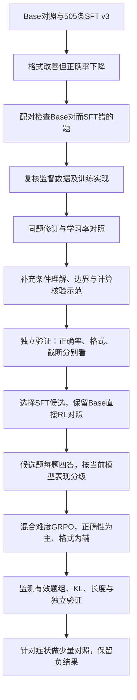

# 项目推进主线：SFT退化分析、补数据、GRPO选题与训练消融

> 2026-10-13数据范围更新：初始505条来源由用户确认为unsloth/OpenMathReasoning-mini。后续MATH L2–3主实验的数据预算统一见[当前数据配置](MATH_L2_L3_DATA_CONFIGURATION.md)；本文旧的多来源配额与固定难度比例仅保留为设计历史。已有混合GRPO训练记录保持原样，不能改写成纯MATH实验。

整理与公开资料核对：2026-10-12。

这份文档围绕“遇到问题—提出解释—设计处理—验证效果—决定下一步”组织。**已确认**表示有本地记录；**待验证**表示下一轮实验设计；**条件分支**表示只有出现相应日志和样本证据才采用。比例、阈值和候选超参数属于本项目的起始方案。

## 1. 先把项目主线串起来



图中E–H包含后续设计。历史主链是**SFT v3直接进入GRPO**；补充SFT、SFT v4和数据修订有各自支线，不能把它们倒排成主GRPO的真实前置步骤。

| 环节 | 现有证据 | 下一轮怎样接上 |
|---|---|---|
| SFT v3退化 | 已确认，格式改善但MATH/GSM8K判对率下降 | 从配对退步题分析，而非只看loss |
| 数据复核 | 已发现错误答案、漏边界和论证缺陷 | 用同题修订对照区分数据内容与更新幅度 |
| 定向补数据 | 已有独立补充集与支线结果 | 按本轮错误类型重新选取，做有对照的实验 |
| 补数据后正确率几乎不涨、收尾改善 | 早期8题收尾支线有局部观察 | 不能外推为v3后大规模已验证结果；新实验实测后再填 |
| GRPO筛题与训练 | 主训练已做G=4、1–3/4筛选 | 新方案进一步记录难度混合、分层与筛选成本 |
| 平台期 | 主checkpoint不单调，已有LR对照 | 优先诊断有效奖励、题池覆盖和更新状态 |
| 奖励欺骗 | 暂无充分证据确认 | 有触发样本才进入评分器/奖励对照分支 |

## 2. 第一次SFT为什么不满意：从同题退步看起

### 2.1 观察到的变化

已有统一v3.2自动评分，MATH测试2024题：

| 指标 | Base | SFT v3 |
|---|---:|---:|
| 最终答案判对 | 1512，74.70% | 1330，65.71% |
| 格式完整且EOS | 63.49% | 91.55% |
| 截断 | 39题 | 114题 |

按题ID配对，Base对而SFT未判对359题，反向改善177题，净少判对182题。359道退步题里：

- 68题SFT截断；291题未截断。
- 277题SFT格式完整且正常EOS，仍未判对。
- 评分状态为incorrect 275、extraction_failed 68、prediction_unsupported 10、prediction_parse_failed 6。这个分类与截断分类不是同一维度，数字相等不表示逐题重合。

这里的“未判对”保留评分不确定性，不能将其全部改称真实数学错误。但277道格式完整的退步题足以说明：仅修输出标签无法解释或解决全部问题。

本次已离线重算配对数量，并查看8道有完整格式、未截断的代表题。证据见[SFT退步题复核JSON](SFT_REGRESSION_REVIEW.json)，复算：

```powershell
python tools/audit_sft_regressions.py
```

脚本只读取已有回答和评分，核对ID、共同题面/gold及输入哈希，不生成新回答、不改评分。8题按问题解释价值选取，不是随机抽样，也不据此估计各语义错误的占比。

### 2.2 具体分析出了什么

以下题号为`math:学科/test-00000-of-00001.parquet:行号`，完整ID保存在JSON中。

| 代表题 | SFT实际错误 | 分析与对应数据需求 |
|---|---|---|
| algebra:82，AMC10+AMC12 | 把五位数相加当成数字求和，最终给0；正确答案14 | 位值关系没有正确建模。补“题意→变量/位值→方程→回代”的短完整示范 |
| algebra:141，二次式为素数 | 因式分解后说正因子相乘必为合数，漏掉n=3时因子1与2 | 缺少边界检查。补因子为0/1、定义域端点和特殊值分类 |
| counting_and_probability:69，车牌计数 | 原题只限制首字母为元音，模型擅自要求其余字母为辅音 | 不是公式不熟，而是添加条件。补逐位置约束与剩余选择数的示范 |
| counting_and_probability:79，代表团排列 | 公式6!×5!×3!×3!正确，乘积写错 | 把建模错误与执行错误分开。补可复核的中间数值和独立检查 |
| number_theory:25，补成完全立方 | 2的指数少补1，所得乘数与立方根也不相符 | 补素因子指数按模3补齐，再代回检查 |
| prealgebra:146，幂运算 | 提公因式时把系数变错，得到64而非40 | 补基础运算与等价变换，避免只选难竞赛题 |
| precalculus:35，中线与余弦 | 对非直角三角形套“邻边/斜边” | 补公式适用条件，示范坐标或余弦定理的正确使用 |
| precalculus:83，正交向量 | 方程列对，联立解错且未代回 | 补“列式→求解→代回两条约束”的闭环 |

**能得出的结论**：SFT后的问题包括条件理解、边界覆盖、计算执行、公式前提与答案核验；格式合规与这些能力并不等价。

**还需检验的解释**：训练示范是否缺少这些行为、是否存在错误示范、更新幅度是否造成能力损失。输出错题本身无法证明某一训练样本导致了退化，也不能据此给“数据是主因”编造概率。

### 2.3 为什么进一步怀疑监督数据

本地训练数据复核提供了另一组独立线索：

- 原抽查中，100!可被24连续整除的最大次数写成48，应按素因子指数得到32；这是明确答案错误。
- 有的示范将“找到一个候选”当作“证明最大/唯一”，缺少其他情形排除。
- 有的示范使用错误单调性支撑唯一性，候选代入正确但证明不成立。
- 另有算术笔误、定义域或整数正性约定没有交代清楚的情况。

因此把**监督质量与覆盖**列为优先排查项是有依据的。原始505条SFT的mask/EOS检查已经通过，最长序列1777、上限2048，无训练样本截断，所以暂不优先归因于“训练时把答案/EOS截掉”。评测生成中的截断另行处理。

来源：[首轮50题复核](../sft_quality_audit_v2/MANUAL_SAMPLE50_REPORT.md)、[剩余455条中50题复核](../sft_quality_audit_v2/REMAINING455_SAMPLE50_REPORT.md)、[独立15题修订](../sft_quality_audit_v2/revision_20261011_user15/README.md)。后续修订文件不等于当时训练的逐字节输入快照。

## 3. 怎么补SFT数据：先修质量，再补缺失行为

针对“尽量保住Base正确率”的新目标，优先采用[SFT能力保持方案](SFT_ACCURACY_PRESERVATION.md)：从训练题筛选Base适配的合格解答、必要格式转换、小幅更新与生成验证。本节原始/修订对照仍用于分析根因，“原集+800”保留为扩充对照，不再默认先追加再扩大训练。

### 3.1 先做小对照，防止“换数据又降LR”无法归因

**待验证：同题2×2对照。**从同一Base新建LoRA，统一seed、模板、有效batch、更新步数和其余参数：

| 组别 | 监督内容 | 学习率 |
|---|---|---:|
| S0 | 当时原始输入快照 | 2e-5 |
| S1 | 同题修订内容 | 2e-5 |
| S2 | 当时原始输入快照 | 5e-6 |
| S3 | 同题修订内容 | 5e-6 |

这个阶段只修答案与推导，不同时扩题、换模板和改变LoRA。无法恢复原始快照时，取消“原始/修订”的严格因果对照，不用后改文件代替原始组。隔离缺条件题造成题集变化时，另记排除项，对共同可用题做对照。

S1优于S0支持数据内容有影响；S2优于S0支持更新幅度有影响；只S3改善提示二者交互。重要差异再补独立训练seed。

### 3.2 备选扩充对照：800条定向示范

基础为复核后可用的原505条，另选800个不同训练问题。最终数量为N+800，N是实际保留数。来源仍以GSM8K train、MATH train中的独立题为主，扩展来源只选能复核且长度合适的示范。

针对当前MATH L2–3评测，800题的来源目标可设MATH train L2–3 600题、GSM8K train 200题。下表是行为标签，和来源是不同维度。保守首轮则将最多800题作为独立候选集从Base训练，不自动与505拼接，详见上面的能力保持方案。

| 补充行为主标签 | 目标条数 | 好示范应体现什么 |
|---|---:|---|
| 条件读取与建模 | 280 | 保留原题条件，不增加限制；文字/位值/单位转为数学关系 |
| 边界与分类完整性 | 240 | 检查0、1、正负、端点、退化情形；交代穷尽依据 |
| 计算与答案核验 | 160 | 核对关键乘积、指数、方程解；实际代回，避免空喊“验证正确” |
| 完整推导与正常收尾 | 120 | 保留必要依据，最终答案与推导一致，输出后正常EOS |

每题只计一个行为主标签，可有多个副标签；同时保留知识点与静态难度。知识点按算术建模/代数/数论计数/几何约40/35/15/10%检查覆盖，难度以基础和中等为主。这些是边际目标，不为填满交叉格加入劣质题。

这800条是针对当前退化的定向实验，和[通用1500题数据方案](DATA_DESIGN_PROPOSAL.md)是两个起步选择，不要求重复叠加。补的是同类技能，**不把已看过的测试原题、翻译或改数字近重复直接塞回训练**。

验收：问题完整、gold可靠、推导可复核、完整prompt+completion+EOS不超2048总token；无图缺失；按题簇去重划分；保留来源版本与修改记录。同题多个解答优先选完整且清楚的一条，而非无条件选最短。

### 3.3 补数据实验怎样比较

在上一阶段选定的配置上，比较“复核后原集”与“复核后原集+800条”，从同一Base初始化。建议共用更新上限，例如最多96步，并在32/64/96步保存和看开发验证；这个上限是预算示例，不是要求跑满。

两组固定有效batch和调度，匹配长度分层，记录实际覆盖题数、原题重复次数和监督tokens。扩充集会改变重复程度；若累计监督tokens差很多，再补等token预算对照。只比较相同epoch会把更多训练量混成数据收益。

开发验证采用预先留出的300题，按GSM8K/MATH各150题、内部知识点分层；与训练题簇互斥。数学判对为主，格式/EOS、截断、重复、长度为辅，loss只作训练状态参考。按验证选择checkpoint，旧MATH测试只作历史复盘，另准备未参与调参的确认数据。

### 3.4 如果“正确率没明显涨，格式/收尾变好”，如何推进

**条件分支，结果待填：**这支持补充SFT对输出行为有帮助，尚未证明解决推理退化。先比较同题改善/退步及其不确定性，并检查基础运算、条件理解等错误是否减少；不把无统计证据的小幅波动叫作能力提升。

有两种合理后续：

1. 若验证正确率保持在预先接受范围，且模型对RL候选题已有可靠成功样本，可以用它作为GRPO候选起点。
2. 若仍明显低于Base，保留Base直接GRPO对照；有格式并不自动证明这个SFT checkpoint是更好的RL起点。

已有早期收尾支线在8题中正确数2→2、EOS 5→6、截断3→2、长度下降，能作为“小样本行为改善”的例子。另一个SFT v4在2024题上为1386题正确，相比v3的1330题多56题、约2.77个百分点，但仍低于Base；二者并非控制变量的同题数据消融，不能归因全部给补数据。**这两份结果都不证明“补数据后正确率几乎不涨”是主链已经发生的事实。**

来源：[8题收尾诊断](../sft_closure_results/REPORT.md)、[v4评测](../datasets/math/sft_v4_vs_base_v32/ANALYSIS.md)。

## 4. GRPO用什么题：先可靠判分，再根据SFT回答分级

当前具体执行以[GRPO数据方案](GRPO_DATA_PLAN.md)为准：512候选试运行，最多1024题合格池，MATH/GSM8K来源软目标75/25。本文保留历史事实与核心设计，不能把新计划回填为历史记录。

### 4.1 适合初版的候选范围

采用GSM8K train＋MATH train L2/L3为主。GSM8K补算术、单位和文字建模，MATH提供更丰富的多步关系、代数、数论计数与几何。优先选择题面完整、最终答案能稳定验证的题。

先按题簇排除SFT、开发验证与外部测试，再用现有Math-Verify链路筛选。实际发现提取/解析异常、单位歧义或题目信息缺失时，再复核对应样本，不按“复杂集合”“多个答案”等名称一律排除。当前MATH数据不预设专门的证明题过滤步骤，检查依据见[当前GRPO数据方案](GRPO_DATA_PLAN.md)。

历史主训练确实使用了这个方向：候选去重10412题，SFT v3每题生成4条，筛出混合正确组；前段准备池3816题。两阶段实际消耗3072个不同问题，而非全部候选。新方案的难度比例需另统计，不能回填成历史配比。

### 4.2 “SFT初筛”具体是什么意思

不是再对候选题做监督训练，而是冻结选定SFT模型，做一次能力校准：

- 每题G=4，temperature=1.0、top_p=1.0，关闭top_k过滤，固定模板/seed约定。
- 统一沿用历史3894 completion token预算，与后续GRPO一致；通用方案原2048筛选预算已撤出当前路线，SFT总序列2048与此不同。
- 保存4条原始回答、各奖励分量、正确数k、未确认数、截断数和配置哈希。
- 初轮抽512题校验评分与成本，流程稳定再扩候选；答案解析不支持与budget_limited分别标注。

仅将评分可确认且预算问题已排除的候选放入主要混合池。四次采样不精确估计真实成功概率，也不是pass@4指标；边界题可少量复测。

### 4.3 最终进入GRPO的难度怎样安排

| 筛选时的k/4 | 训练角色 | 初版入池目标 |
|---|---|---:|
| 3/4 | 过渡题，巩固已有能力并纠正少量失败 | 25% |
| 2/4 | 核心题，成功与失败都有明显样本 | 50% |
| 1/4 | 挑战题，已有成功路径但不稳定 | 25% |
| 0/4 | 核验gold、评分、预算并少量重测 | 不直接放主池 |
| 4/4 | 容易题诊断、后续重测 | 不直接放主池 |

首轮合格池最多1024道不同题，MATH/GSM8K软目标768/256；先用512候选题pilot估计各来源合格率，再分批扩筛。首轮256 updates约消费512个问题位置，实际消耗从rollout统计；不再将1500–3000题作为首轮目标。优先可靠性、知识点覆盖与MATH为主，难度比例可因合格量调整，禁止复制稀缺题凑数。

25/50/25是待检验的静态混合方案，不是开源项目已经证明的最优比例。初版也不预设必须先易后难，固定混合更便于复现和归因。

筛选时1–3/4，训练重新采样仍可能0/4或4/4。继续记录**总奖励**零方差题组比例，必要时重新校准剩余题；全同正确性但格式不同仍可能有策略信号。参考[Open-R1采样筛选](https://github.com/huggingface/open-r1/blob/main/scripts/pass_rate_filtering/README.md)，在线过滤机制参考[DAPO](https://arxiv.org/html/2503.14476v2#S3.SS2)，二者不保证本项目涨点。

## 5. 奖励保持简单：正确性为主，格式为辅

参考[DeepSeek-R1原始报告的R1-Zero奖励设计](https://arxiv.org/html/2501.12948v1#S2.SS2.SSS2)，采用规则验证的正确性与格式两类奖励；不称为完整复现DeepSeek-R1多阶段训练。**1与0.1的具体配重、项目自定义标签来自本项目实现，不声称是论文公布的原始数值。**

沿用现有主训练基线：

```text
r_answer = 1（最终答案可验证为正确），否则0
r_format = 0.05×合法推导结束边界
         + 0.03×合法非空SOLUTION
         + 0.02×完整格式且正常EOS
r_total = r_answer + r_format                  # 范围0–1.1
advantage_i = (r_i - group_mean) / (group_sample_std + 1e-4)
```

KL以beta加在loss中，不混入上面的reward汇总。正确性为0/1是训练信号，无法解析回答仍保留未知标记供审计，不能在报告中把它们全部称为数学错误。暂不加过程奖励、复读惩罚、长度惩罚或LLM judge。

判分只读取合法最终答案，支持经过测试的等价数值/表达；不能在推导里搜索gold。检查多答案冲突、错误单位、错百分比、末尾改答案、答案后续写等反例。奖励参考答案不放入用户prompt。

已有实现中，一条回答无EOS会屏蔽同题四回答整组的策略与KL损失。新实验先固定这项策略并报告屏蔽率；改变屏蔽方式属于单独实验，不能悄悄变成“默认行为”。

## 6. GRPO初始化参数与哪些值得调

### 6.1 先固定可复现的基线

“初始化”指项目自己的明确基线，不依赖不同TRL版本的隐式默认值：

| 项目 | 起始值 | 用途 |
|---|---|---|
| LoRA | r32、alpha64、dropout0 | 沿用架构设置 |
| learning_rate / scheduler | 5e-6 / linear | 先复现主阶段配置，再做LR粗对照 |
| warmup | 2 updates | 保留历史基线；调度对照双方保持一致 |
| G / temperature | 4 / 1.0 | 组内比较与探索 |
| top_p / top_k | 1.0 / 关闭过滤 | 不同时扫多种解码参数 |
| microbatch / accumulation | 2 / 4 | 每次更新8条回答，通常来自2道题 |
| generation batch | 32条回答 | 8道题的一次生成，分给4次更新；与有效训练batch区分 |
| num_iterations | 1 | 初版不反复复用同批轨迹 |
| max_prompt / completion | 1024 / 3894 tokens | 先统计真实长度并检查prompt是否被截断 |
| KL beta / reference | 0.04 / 初始SFT checkpoint固定 | 不把reference自动滚动到上一步 |
| GRPO clip / max_grad_norm | 0.2 / 1.0 | 保持基础稳定性设置 |
| optimizer / weight_decay | AdamW 8bit / 0.01 | 初版不作搜索维度 |
| loss / reward scaling | grpo / group | 不同时换loss算法和奖励归一化 |
| vLLM重要性修正 | 开启，上限2 | 固定采样/训练差异处理并检查尾部 |

首轮采用256更新的筛查预算，每64步保存/开发验证；在完整有效且无额外补采样时，约512问题位置、2048回答。是否独立问题、有效组数及实际tokens仍从rollout统计，预算上限不写成完成数。通过pilot再决定扩大训练。

### 6.2 优先级：先排故，再做少量参数实验

| 优先级 | 因素 | 何时值得动 | 起始对照 |
|---|---|---|---|
| 最高 | gold/评分器、监督内容、题池可学习性 | 已有数据或奖励异常证据 | 先离线复核，再同起点短训 |
| 高 | 学习率 | 有有效advantage但更新过弱，或KL/梯度持续异常 | 2e-6 vs 5e-6，先两档 |
| 高但有条件 | completion预算/截断策略 | 失败集中于长度上限或屏蔽过多 | 先同题预算诊断，再决定单独训练对照 |
| 中但有条件 | KL beta | 更新受约束，或持续漂移伴随验证退化 | 保守基线0.04；过约束时试0.01，过度漂移时先降LR，再考虑0.08 |
| 中但有条件 | temperature | 成功路径存在但采样趋同，或输出明显失控 | 0.8 vs 1.0，G保持4 |
| 中但有条件 | 静态筛题/在线补采样 | 总奖励零方差比例高，实际有效组不足 | 静态池 vs 有上限补采样 |
| 暂不扫 | G、batch、LoRA rank、optimizer、clip、loss_type、weight_decay | 没有明确指向性症状 | 固定；出现对应瓶颈再单独讨论 |

“暂不扫”不表示这些参数不重要；它表示在单卡预算和现有证据下，继续扩大搜索不划算。G=8会增加每题生成成本，固定回答预算还会减少问题覆盖，不能将G4/G8简单当等成本纯参数实验。

KL、entropy和clip日志用于解释，不能靠一个绝对阈值选最优参数。组内标准化下loss大小也不直接代表数学能力。指标含义参考[TRL 0.23.1 GRPO文档](https://huggingface.co/docs/trl/v0.23.1/en/grpo_trainer#logged-metrics)，具体历史字段以本项目日志为准。

## 7. 如何根据训练日志决定下一步

每64步汇总只是建议监控节奏；同时保留逐组rollout。reward、KL、梯度和长度既看均值也看分位数/最大值，按来源与难度桶拆开。

| 现象 | 先核对什么 | 支持解释后的行动 | 验证成功的标准 |
|---|---|---|---|
| train reward上升，开发正确率不升 | 正确性/格式各自变化，训练题复用，判分反例 | 针对格式投机、过拟合或题池饱和分别处理 | 独立开发正确率与同题错误类型，不以reward均值代替 |
| 大量总奖励零方差组 | mask前后组数、各奖励分量、难度与来源 | 有上限补采样或重新校准剩余候选 | 单位生成token的有效组与验证效果改善 |
| 总奖励有差异，但参数更新很弱 | 实际LR、非零梯度、adapter变化、策略/KL项相对规模 | 做LR粗对照；有过约束证据再试beta | 更新恢复且验证改善，而非仅梯度更大 |
| KL/梯度持续尖峰、验证变差 | 原始长回答、logprob尾部、mask、权重同步和数值 | 先排实现，降LR；必要时再试更强KL | 尾部异常减少且没有数学退化 |
| entropy/回答多样性下降 | 同题重复、采样seed、温度、成功路径是否存在 | 先保证采样独立；有必要做温度对照 | 有效混合组增加，并看相同生成预算下验证收益 |
| 截断/无EOS增加 | 哪个桶发生、题面预算、最长回答和重复 | 同题放宽预算诊断；复核收尾；再考虑独立长度策略实验 | 截断减少且正确率保持，不只回答变短 |
| 连续几个checkpoint变化很小 | 逐题改善/退步、难度桶、成本、上述信号 | 保留较早候选，优先一个证据最强的分支 | 新配置需独立验证；否则不继续盲目堆步数 |

静态题池在线补采样起始上限可设每次目标批最多3轮候选生成，整组保留/丢弃并记录；到上限仍不足则跳过该次更新并记录，不无限重试、不拆组。两臂比较按总生成token上限，另报实际updates、wall time、有效题组；不是只对齐optimizer steps。这个策略尚未实施。

### 7.1 平台期：已有证据支持到哪里

主实验MATH判对数1024/1280/1536步为1463/1454/1469，GSM8K为1133/1131/1131，不呈持续上升。小幅差异没有证明稳定优胜。

已有LR续训对照从1024 checkpoint起各训练256步，恒定2e-6相对线性衰减，在历史v2评分MATH200多对3题、GSM8K少对9题；配对区间未排除波动。因此**没有验证恒定LR解决平台期**。两组warmup不同，下一轮若专门测scheduler，需要统一warmup、初始状态、数据与预算。

主训练事后审计的0/4与4/4占约25.2%，不是早期C64支线47.73%的总奖励零方差比例。主阶段仍有大量混合组，需看实际总奖励方差，不能声称全部平台期由无信号题导致。

### 7.2 奖励问题：已发现漏判，不等于已发现欺骗

已确认的主训练奖励漏判：6032条MATH回答里12条从0改1，涉及11组。一组从`[1.1,0.1,0.1,1.1]`变成`[1.1,0.1,1.1,1.1]`，被修正回答的减均值项从−0.5变+0.25。离线评分修复改变了学习信号，历史权重未重训。

“奖励欺骗”需要另一类证据：模型通过错误但规则给高分的输出获得收益，且训练中该行为增加。例如推导中堆候选答案、冲突多答案仍获正确奖励、答案后改口却被忽略。这些是检查用反例，尚非本项目已确认训练行为。

若确实发现：冻结样本和旧规则→独立核验→补正反例→修评分器→同一正常起点对照训练。若坏行为已明显学入，优先从受污染前checkpoint恢复，而非只改评分后沿旧权重继续。效果先报告误判数/advantage变化，再报告独立训练收益。

格式奖励还可能仅改善标签而不改善答案，这叫目标偏向，未必是模型利用漏洞。用correctness-only与correctness+format对照；若去掉格式奖励数学无损而格式明显下降，需要按项目目标权衡，不能自动宣称格式奖励有害。

## 8. 最小可执行消融安排：不把所有参数做网格搜索

下表为待执行清单。各对照内部同初始化、题池与顺序约定、奖励版本、模板和预算；相同seed不能保证策略分叉后的回答一样。

| 编号 | 要回答的问题 | 对照设置 | 为什么做 / 何时做 |
|---|---|---|---|
| S-A | 数据质量还是更新幅度？ | 原始/同题修订 × lr2e-5/5e-6 | SFT退化优先项，先恢复可比快照 |
| S-B | 定向补800题是否有帮助？ | 复核原集 vs 加800题；同一选定LR | S-A后做，记录监督tokens与重复程度 |
| R-0 | SFT是否是更好的RL起点？ | Base直接GRPO vs 选定SFT后GRPO | 共用可靠核心题池作起点对照；各自筛池另作完整策略比较 |
| R-1 | 模型相对难度筛选是否有价值？ | 同来源的静态等级池 vs G4分级混合池 | 控制规模，匹配/报告内容与长度；记录筛选成本 |
| R-2 | 更新幅度是否合适？ | lr2e-6 vs 5e-6，均linear、warmup2 | 先256更新筛查，最多两档 |
| R-3 | 格式辅助奖励是否值得？ | 正确性only vs 正确性+上限0.1格式 | 复用可比基线，有reward/正确率背离或格式目标取舍时做 |
| R-4 | 平台期是否受零方差题组限制？ | 静态池 vs 有上限在线补采样 | 仅日志支持有效组不足时做，匹配生成token预算 |
| R-5 | KL或温度是否成为瓶颈？ | beta或T任选一个两档对照 | 只有相应日志证据时做，不同时改两项 |

先完成SFT排查，进入RL后优先R-1和R-2。已有LR续训与奖励支线提供线索，但评分器/初始化不同，不能直接替代新实验基线。R-0用于验证SFT必要性，预算不足时保留为重要未解决项，而非默认SFT一定有益。R-3至R-5按症状触发，不必全部跑。

R-0两臂各自以自身初始策略作为固定KL reference，属于完整起点策略比较；其KL约束中心也随起点不同，解释时一并说明。其余SFT后GRPO实验固定同一个SFT reference。

选择配置时：

1. 在固定300题开发集上，分别报告GSM8K/MATH正确率；如需一个选型分数，预先使用两者正确率等权平均，不按题量混成总准确率。
2. 格式目标可预设为完整且EOS不低于90%，这是项目要求示例；若无配置满足，保留候选并说明，不能选完再改门槛。
3. 主指标接近时优先更少截断、更低成本；不单凭更短获胜。
4. 先单seed筛查明显失败方案，主要候选补至至少两个独立训练seed，配对不确定性另报。多个checkpoint择优有选择偏差，最终用未参与调参的确认数据评估。
5. 没有一致收益就保留原配置或较早checkpoint。按同等生成成本比较；不把“试了更多组合”当成改进。

## 9. 面试中怎样把这段经历连贯地说出来

### 已有证据可以支撑的讲法

> 我最初用505条数据对Qwen3-4B-Base做QLoRA SFT，希望模型按指定格式给出推导与答案。但统一评测发现格式提高了，数学正确率反而下降，所以我没有继续凭loss下降追加epoch。
>
> 我先按题ID找Base答对而SFT未判对的题，事后配对统计有359道。部分是截断，但也有277道格式完整且正常结束，说明不能只修标签。我查看了典型回答，发现条件建模错误、漏掉因子为1的边界、擅自增加题目限制，以及方程列对但计算和回代出错。
>
> 接着复核监督数据，确实找到错误答案和不充分证明，因此把监督质量与覆盖列为优先排查项。不过输出错题不能单独证明数据是全部根因，我还保留学习率/更新幅度的解释，计划用同题修订与两档LR对照分离。
>
> 历史主链使用SFT v3继续GRPO。从GSM8K和MATH训练题中，每题采样4次，选择有正确也有错误的题。这样能够利用相对奖励，而不是只按原始题目等级认定难度。主训练使用答案0/1加小幅格式奖励，KL单独约束，并保存实际题组、奖励和训练日志。
>
> 后期checkpoint没有持续涨点，我做过学习率调度对照，但没有两个测试集一致的收益，所以没有说平台期已经解决。奖励审计则确认部分正确回答被漏判，修正后同组advantage会改变；这项离线修复尚不等于模型重训收益。
>
> 最终GRPO相对SFT恢复了一部分正确率并改善收尾，但MATH仍低于Base。我更看重能把错误类型、训练信号和消融对应起来，知道下一轮该验证什么，而不是把每次改动都解释成有效。

### 尚未完成的“补数据→分级GRPO”怎样衔接

> 下一轮我会先修复监督质量，再补条件建模、边界分类、计算核验和正常收尾四类示范。假如实验主要改善格式而数学提升有限，我会把它作为行为冷启动候选，同时保留Base直接RL对照，不预设SFT一定是最佳起点。
>
> 选定起点后，用它每题采样4次，把GRPO题分为3/4、2/4、1/4，先试25/50/25的固定混合。训练先固定奖励和多数参数，主要比较两档学习率；只有日志表明KL过约束、采样趋同或总奖励零方差组太多时，再分别做对应实验。结果实测后再决定采用哪项。

### 面试官最可能追问的四点

| 追问 | 回答核心 |
|---|---|
| 你怎么知道是数据，不是LR？ | 数据复核有具体错误，但根因贡献还需同题2×2对照 |
| 2/4题一定最好吗？ | 不一定；G4估计粗、样本会重采，比例是待验证假设 |
| reward上涨为什么不够？ | 格式可单独上升，评分器也可能出错；要看独立正确率与实际奖励差异 |
| 为什么不调更多参数？ | 固定基线后按日志触发对照，单卡先验证数据、奖励和更新幅度 |

## 10. 证据入口与来源边界

- [MATH任务划分与SFT能力保持](SFT_ACCURACY_PRESERVATION.md)：同等级train/test边界、Base适配示范、更新/DFT对照与非劣验证。
- [主训练交付报告](../deliverables/SFTv3_GRPO_1536_training_handoff/TRAINING_REPORT.md)：历史SFT/GRPO参数、候选与实际消耗。报告内“尚未评测”等语句是当时状态，后续结果见下面统一评测。
- [统一评测与逐题配对](../datasets/math/test_l2_l3_remaining_v1/combined_analysis_v32_final/ANALYSIS.md)、[本次8题复核](SFT_REGRESSION_REVIEW.json)：实际退化与错误例子。
- [补充1390题审查及1379题可用版本](../datasets/math/sft_v3_supplement_unseen_grpo1536_v3_review/README.md)：模型辅助审查与隔离记录，不能等同于独立数学认证或训练完成状态。
- [学习率续训对照](../lr_ab256_experiment/ANALYSIS.md)、[训练问题复盘](TRAINING_RECORD.md)：已有异常、处理与负结果。
- [数据设计细则](DATA_DESIGN_PROPOSAL.md)：来源、内容/难度标签、分簇划分与数据字段。

公开参考只支持方法来源：DeepSeek-R1支持规则正确性/格式奖励方向，Open-R1支持采样正确率筛选，DAPO支持在线过滤无差异题组的机制，TRL说明相应训练指标。本文的补充配额、混合比例、参数档位和监控节奏是结合本项目资源提出的设计，没有借用上游收益作为本项目结果。

本次完成文档、保存回答的离线配对审计和8个代表题复核；没有新训练、生成或改写历史模型结果。
