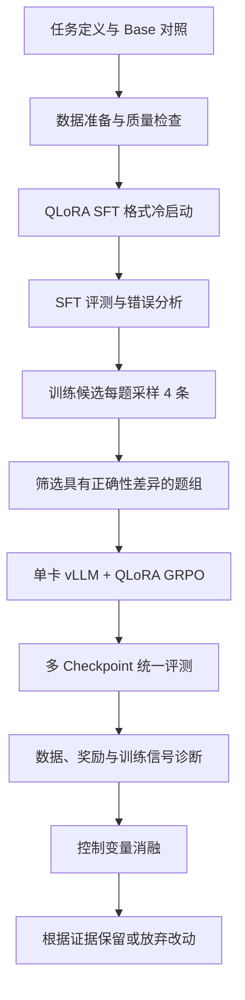

# 项目 Pipeline：Qwen3-4B 单卡数学推理后训练

项目定位：基于 TRL、vLLM 等开源工具，完成 QLoRA SFT、GRPO、统一评测与训练问题诊断。

当前数据范围（2026-10-13）：初始505条SFT来自用户确认的unsloth/OpenMathReasoning-mini；后续以MATH train/test Level 2–3为主，GSM8K仅作可选补充。新实验预算见[MATH主线配置](MATH_L2_L3_DATA_CONFIGURATION.md)，历史混合训练数量不改写。

本文按工程流程组织已有工作，不代表所有诊断都在训练当天完成。已有训练、事后审计和待做消融分别标注；不同阶段的模型、数据、奖励和评分口径不能直接混用。

## 总体流程

## 1. 定义任务，建立 Base 对照

目标同时包含四个方面：

- 数学最终答案正确。
- 按要求输出推导和最终答案标签。
- 正常结束，减少截断和重复。
- 在单卡条件下控制训练与生成成本。

保存 Base 的逐题回答作为对照。比较模型时使用相同题目、prompt 和解码配置，避免把评测条件变化当作训练收益。未确认评分保留在分母中，不能只统计可解析回答。

**产物：**评测配置、Base 逐题回答、基线指标。

**状态：**已有 Base 与多模型评测记录；当前统一汇总采用 `audited-final-answer-v3.2`。

## 2. 准备数据，检查质量与泄漏

SFT v3 使用 505 条题目与解答。GRPO 候选来自 GSM8K train 与 MATH train 的 Level 2–3。

检查内容：

- 题目、推导、最终答案是否完整，数学内容是否存在明确错误或条件缺失。
- 标签和 EOS 是否符合训练模板。
- tokenizer 编码后是否超过训练长度。
- 训练、验证和测试之间是否有规范化精确重叠。
- 数据版本、来源和 SHA256 是否可追溯。

数学内容复核与结构检查分开。结构通过不代表数学内容正确，规范化精确去重也不代表不存在语义重叠或预训练污染。

后续修改的数据建立新版本，不能把修改后的本地数据冒充当时训练的逐字节快照；修改数据不会改变已有 adapter。

**产物：**版本化 JSONL、数据审计报告、划分及排除清单。

**状态：**已有准备、检查及后续修订记录。具体训练输入以对应启动归档和 manifest 为准。

## 3. QLoRA SFT：格式冷启动

| 项目 | SFT v3 实际配置 |
|---|---|
| 起点 | Qwen3-4B-Base，新建 LoRA |
| 训练方式 | NF4 QLoRA，冻结 Base |
| LoRA | r=32，alpha=64，dropout=0 |
| 数据 | 505 条训练样本 |
| 验证 | 57 条既有 SFT 验证样本，仅监控 loss |
| 有效 batch | 16 |
| 学习率 | 2e-5 |
| 训练量 | 1 epoch，32 次 optimizer 更新 |
| 序列上限 | 2048，实际训练序列最长1777，无截断 |
| 监督范围 | completion 和真实 EOS，屏蔽 prompt/padding |

这一步的目标是格式冷启动，并检验能力是否保持。训练 loss 或验证 loss 下降不能代替数学生成评测；57 条 SFT 验证样本不是独立数学 benchmark。

**产物：**SFT adapter、训练配置、loss、监督 mask 与 EOS 检查记录。

**状态：**SFT v3 已完成。

## 4. 评测 SFT，确定后续问题

统一 v3.2 评分口径下，MATH L2–3 共2024题的结果：

| 指标 | Base | SFT v3 |
|---|---:|---:|
| 自动判对率 | 74.70% | 65.71% |
| 格式且 EOS | 63.49% | 91.55% |
| 截断率 | 1.93% | 5.63% |

结论是格式遵循提高，但数学正确率下降、截断增加。因此形成两个后续方向：

1. 用 GRPO 检验可验证奖励是否能恢复正确率和改善收尾。
2. 将 SFT 数据质量与更新幅度列为待消融的原因，不提前认定根因。

**产物：**Base/SFT 配对比较、错误案例、待验证假设。

**状态：**已有评测和事后分析。此处按流程汇总，不补写当时尚未形成的诊断时间线。

## 5. 构建 GRPO 题池

本节描述已有历史流程；下一轮的来源划分、预算与配比统一见[当前GRPO数据方案](GRPO_DATA_PLAN.md)。

用 SFT 模型对训练候选每题采样4条回答，计算正确数，优先选择1/4、2/4、3/4正确的混合组，并排除已知重叠及不合格候选。

GRPO依靠同题回答之间的奖励差异学习。筛选时有差异的题更可能提供有效信号；训练时会重新采样，因此不能保证在线每组仍有差异。

必须区分候选池大小与实际训练覆盖。正式两阶段累计实际使用3072个不同题组，不能把准备池全部写成已训练。

**产物：**候选题池、筛选回答、正确数组分布、排除记录、实际消耗题目清单。

**状态：**已有筛选与实际消耗审计。

## 6. 单卡 GRPO 训练

主实验训练设置：

- 每题4条回答。
- 正确性奖励0/1，格式奖励最高0.1。
- 组内标准化计算 advantage。
- KL系数0.04，单独进入loss，不包含在总奖励中。
- NF4策略训练与BF16 vLLM生成交替运行。
- 检查冻结权重未被修改、权重同步、有限梯度及adapter实际更新。
- 记录采样侧与训练侧log-prob差异，启用vLLM重要性修正。

| 阶段 | 更新次数 | 峰值学习率 | 恢复方式 |
|---|---:|---:|---|
| 第一阶段 | 1024 | 5e-6，线性衰减 | 从SFT v3 adapter开始 |
| 第二阶段 | 额外512 | 2e-6，线性衰减 | 加载1024步adapter，重建optimizer/scheduler |

累计1536次更新、3072个不同题组、12288条回答。第二阶段不是optimizer state的无缝恢复。

历史主实验只要同组有回答没有EOS，就屏蔽整组损失，实际屏蔽53组。这是需要记录、审计并考虑消融的训练选择，不假定必然最优。

上述主实验奖励不同于早期B/C的结束奖励和软长度惩罚，不能混成同一套配置。

**产物：**checkpoint、rollout、奖励分量、KL、梯度、同步及实际消耗数据记录。

**状态：**两阶段训练已完成，训练资料已归档；完整GRPO权重未包含在本地训练交付包中。

## 7. 多 checkpoint 统一评测

主要比较Base、SFT v3与GRPO-1024/1280/1536。另有SFT v4的MATH评测，不把它当作主GRPO链路中的同一模型版本。

| 维度 | 指标 |
|---|---|
| 答案 | 自动判对率、未确认评分数量 |
| 收尾 | EOS、截断率 |
| 格式 | 格式完整率、格式且EOS |
| 长度 | 平均和中位tokens |
| 行为 | 重复启发式指标 |
| 配对 | 同题改善数、退步数 |

GSM8K与MATH分开报告。MATH旧200题已参与反馈，与剩余1824题分开展示；旧200题已包含在2024题中，不能重复累计。剩余题也已经被观察，未来继续调参时不能再叫全新盲测。

已有结论：GRPO-1536相对SFT v3，将MATH自动判对率从65.71%恢复到72.58%，截断率从5.63%降至2.57%；但MATH判对率仍低于Base的74.70%。自动判分不认证逐步推导。

**产物：**统一评分结果、配对比较、子集汇总、离线结果页、来源及哈希。

**状态：**已有评测；新增CPU工具可验证固定输入并复算汇总，不重新推理或判分。

## 8. 诊断后做消融，决定是否保留改动

| 问题 | 诊断或消融 | 当前状态 |
|---|---|---|
| 新增奖励没效果 | 检查触发率、奖励共线性、advantage变化 | 已发现早期B/C奖励缺少可识别的独立信号 |
| 正确答案被判错 | 修复提取与等价判断，离线重评分 | 已修复部分漏判，未据此重训 |
| 后期收益平台 | 恒定LR与线性衰减对照 | 已做，未见一致收益；使用历史评分口径 |
| SFT正确率下降 | 同题复核数据×两档LR | 待做 |
| 大量零优势组 | 静态题池与有限在线补采样对照 | 待做 |
| 生成加速是否改善总效率 | 分阶段计时与成本对照 | 已有生成benchmark，端到端收益待验证 |

消融的基本要求：

- 从同一初始checkpoint开始，固定数据版本、题序和其他配置。
- 一次检验一个问题，或用明确的因子实验分离数据与学习率影响。
- 保存实际采样、有效mask和奖励，不只看loss或奖励均值。
- 使用独立验证数据选择方案，不反复根据最终测试集挑配置。
- 主要候选补充独立训练seed，区分训练随机性与测试题波动。
- 比较采样策略时统计生成token及wall time，不能只对齐optimizer steps。
- 改进无效或退化时保留负结果，不据次要指标宣布成功。

早期B/C长度惩罚没有触发、结束奖励接近正确性奖励的正比例缩放；这是已确认的实验可识别性问题，不表示这些奖励在所有设置下无效。

**产物：**假设、对照配置、消融结果、保留或放弃改动的依据。

**状态：**已有部分诊断及LR对照，其他项仍为计划。本次文档整理未启动新训练。

## 面试中的项目概括

> 我基于开源TRL与vLLM完成了单卡Qwen3-4B数学后训练。先建立Base对照，用QLoRA SFT学习输出格式，再通过候选筛选和GRPO优化回答。随后结合逐题评测与rollout审计，定位奖励缺少独立信号、答案漏判及训练收益平台等问题，用控制变量实验检验改进。GRPO相对SFT恢复了部分正确率并改善收尾，但MATH仍低于Base，因此保留对照和负结果，继续定位SFT退化原因。

展示重点是训练链路、具体诊断、对照设计与证据，不声称提出新算法或复现完整DeepSeek-R1；本人贡献范围应与实际参与程度一致。

## 配套文档与结果

- [MATH任务划分与SFT能力保持](SFT_ACCURACY_PRESERVATION.md)：当前优先方案，参考自身轨迹筛选、模型适配示范与DFT等方法，尚未训练。
- [项目推进主线与消融安排](PROJECT_DEVELOPMENT_STORY.md)：SFT退步题分析、定向补数据、GRPO分级选题及按日志调整的完整决策过程。
- [SFT与GRPO数据设计方案](DATA_DESIGN_PROPOSAL.md)：参考开源项目的内容分层、难度分层、选数与消融建议，尚未执行。
- [训练困难、原因判断与面试官评价](TRAINING_DIAGNOSIS.md)
- [实验故事与面试讲稿](INTERVIEW.md)
- [下一轮实验计划](NEXT_EXPERIMENTS.md)
- [复现范围与环境](REPRODUCIBILITY.md)
- [离线评测页](../reports/portfolio/index.html)

整理日期：2026-10-12。具体历史参数与来源以对应run manifest、启动归档和训练报告为准；较新的评测汇总不能回写成当时已知结果。
